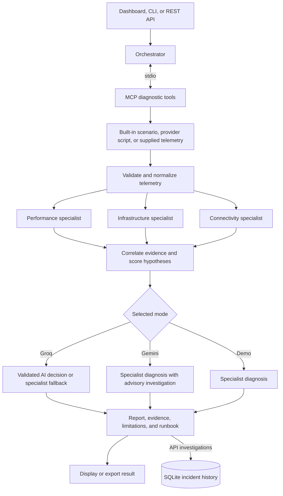

# NetCoop AI

**Evidence-based network fault diagnosis with specialist agents, MCP tools, and optional Groq or Gemini integration.**

NetCoop AI analyzes network telemetry and produces a probable cause, supporting evidence, alternative explanations, confidence, and recommended next steps. A browser dashboard shows the investigation as it runs, alongside an illustrative 3D campus view.

The bundled scenarios and telemetry provider generate **simulated data**. They do not monitor real network equipment. Recommendations require human review; NetCoop does not execute repairs.

## Contents

- [Features](#features)
- [Application workflow](#application-workflow)
- [Windows setup with PowerShell](#windows-setup-with-powershell)
- [Configuration](#configuration)
- [Using the dashboard](#using-the-dashboard)
- [Command-line usage](#command-line-usage)
- [REST API](#rest-api)
- [Telemetry and providers](#telemetry-and-providers)
- [Project structure](#project-structure)
- [Development and testing](#development-and-testing)
- [Troubleshooting](#troubleshooting)

## Features

- Three deterministic specialists analyze performance, infrastructure, and connectivity concurrently.
- A real Model Context Protocol (MCP) connection over stdio exposes diagnostic tools.
- Telemetry validation checks types, ranges, device IDs, topology, completeness, and freshness.
- Legacy schema `0.9` is normalized to schema `1.0`.
- Groq can select the final diagnosis from telemetry and specialist evidence.
- Gemini can investigate through read-only tools and add an advisory explanation.
- Missing keys or unavailable AI services leave the specialist diagnosis available.
- The dashboard streams investigation events, displays evidence, and supports report export.
- API investigations are stored in SQLite, retaining the latest 100 incidents; the history endpoint lists the latest 20.

### Diagnosis modes

| Mode | Behavior | API key |
| --- | --- | --- |
| `demo` | Deterministic specialist analysis and correlation | None |
| `groq` | Groq selects the cause, confidence, and alternatives; specialist baseline is retained | `GROQ_API_KEY` |
| `gemini` | Specialist diagnosis plus Gemini investigation; Gemini does not override the scored result | `GEMINI_API_KEY` |

The specialists are rule-based diagnostic functions. External language models are used only in the selected AI mode.

## Application workflow



1. **Start an investigation.** Choose a scenario or supply telemetry, then select a diagnosis mode.
2. **Connect tools.** The orchestrator starts the MCP subprocess, initializes its session, and discovers tools.
3. **Collect and validate.** Read the selected telemetry, normalize its schema, and assess data quality.
4. **Analyze concurrently.** Performance checks traffic metrics; infrastructure checks device and interface health; connectivity checks wireless and service health.
5. **Correlate evidence.** Combine specialist support into ranked causes. In the deterministic path, stale, incomplete, weak, or closely competing evidence can produce `insufficient_evidence`.
6. **Apply the selected AI mode.** Groq may replace the baseline decision after response validation and data-quality checks. Gemini adds a read-only investigation, limited to four model turns and six tool calls.
7. **Build the report.** Include supporting measurements, affected devices, alternatives, quality warnings, and recommended actions. API runs are saved to history; CLI runs print or write their result.

Possible causes: `normal`, `link_congestion`, `weak_wifi`, `interface_fault`, `dns_dhcp_failure`, `device_overload`, and `insufficient_evidence`.

Confidence is an estimate, not a calibrated probability. A scenario named `hardware_failure` does not prove that physical hardware has failed.

## Windows setup with PowerShell

### 1. Install prerequisites

- Python **3.11 or newer** with the Python launcher available.
- Git.
- PowerShell and a modern browser.
- Internet access for dependency installation and optional AI requests.

Check your tools:

```powershell
py --version
git --version
```

No Node.js build or separate database installation is required.

### 2. Clone the repository

```powershell
git clone https://github.com/1vansh-5/NetCoop-Ai.git
Set-Location .\NetCoop-Ai
```

Run the remaining commands from this repository folder, beside `server.py`.

### 3. Create the Python virtual environment

```powershell
py -m venv .venv
.\.venv\Scripts\python.exe -m pip install --upgrade pip
.\.venv\Scripts\python.exe -m pip install -r requirements.txt
```

`.venv` contains Python and the installed packages. `.env`, created next, is a separate configuration file containing API keys and settings.

These instructions call the virtual environment's Python directly, so activation is optional and no PowerShell execution-policy change is needed.

### 4. Create `.env` from PowerShell

Create the file only if it does not already exist:

```powershell
if (-not (Test-Path -LiteralPath .env)) {
    New-Item -ItemType File -Path .env | Out-Null
}
```

You do not need an `.env.example`. For offline demo mode, the file can remain empty; skip to step 6.

### 5. Add your API key directly through PowerShell

Choose the provider you intend to use. Only one key is required for that provider's mode.

First, paste this helper into the same PowerShell window. It adds or updates a setting without replacing unrelated settings and writes UTF-8 **without a byte-order mark (BOM)**, as required by the application's simple `.env` loader.

```powershell
function Set-NetCoopEnv {
    param(
        [Parameter(Mandatory = $true)][string]$Name,
        [Parameter(Mandatory = $true)][string]$Value
    )

    if ($Value -match "[\r\n]") {
        throw 'Enter a single-line value.'
    }

    $envPath = Join-Path (Get-Location).Path '.env'
    $lines = @()
    if (Test-Path -LiteralPath $envPath) {
        $lines = @([System.IO.File]::ReadAllLines($envPath))
    }

    $pattern = '^\s*' + [regex]::Escape($Name) + '\s*='
    $lines = @($lines | Where-Object { $_ -notmatch $pattern })
    $lines += "$Name=$Value"

    $encoding = [System.Text.UTF8Encoding]::new($false)
    [System.IO.File]::WriteAllLines($envPath, [string[]]$lines, $encoding)
}

function Set-NetCoopApiKey {
    param([Parameter(Mandatory = $true)][string]$Name)

    $secret = Read-Host "Paste your $Name and press Enter" -AsSecureString
    $credential = [System.Net.NetworkCredential]::new('', $secret)
    try {
        $value = $credential.Password.Trim()
        if ([string]::IsNullOrWhiteSpace($value)) {
            throw 'The API key cannot be empty.'
        }
        Set-NetCoopEnv -Name $Name -Value $value
        Write-Host "$Name saved to .env."
    }
    finally {
        $value = $null
        $credential = $null
        $secret.Dispose()
    }
}
```

**Option A: Groq**

Create a key in the [Groq Console](https://console.groq.com/keys), then run:

```powershell
Set-NetCoopApiKey -Name GROQ_API_KEY
Set-NetCoopEnv -Name GROQ_MODEL -Value 'openai/gpt-oss-20b'
```

Paste the key at the hidden prompt. The model above is the fallback model named in `groq_decision.py`; your account must have access to it and it must support JSON object responses. Change `GROQ_MODEL` if necessary.

**Option B: Gemini**

Create a key in [Google AI Studio](https://aistudio.google.com/apikey), then run:

```powershell
Set-NetCoopApiKey -Name GEMINI_API_KEY
Set-NetCoopEnv -Name GEMINI_MODEL -Value 'gemini-flash-latest'
```

You can run both options to configure both modes. These commands also work when replacing a key later; define the helper functions again if you open a new terminal.

The hidden prompt keeps the key out of the command itself and terminal output. The application still needs the key stored as plain text in `.env`; keep that file private.

**Exclude local secrets and generated files from Git:**

```powershell
$ignoreEntries = @('.env', '.venv/', '__pycache__/', '.pytest_cache/', 'data/')
if (-not (Test-Path -LiteralPath .gitignore)) {
    New-Item -ItemType File -Path .gitignore | Out-Null
}
$existingEntries = @(Get-Content -LiteralPath .gitignore)
foreach ($entry in $ignoreEntries) {
    if ($existingEntries -notcontains $entry) {
        Add-Content -LiteralPath .gitignore -Value $entry -Encoding utf8
    }
}
git check-ignore .env
```

The final command should print `.env`. Ignore rules do not remove files already tracked by Git; never commit a real API key.

### 6. Start the application

```powershell
.\.venv\Scripts\python.exe -m uvicorn server:app --host 127.0.0.1 --port 8000
```

Keep this terminal open. Visit:

| Address | Purpose |
| --- | --- |
| [localhost:8000](http://127.0.0.1:8000) | Campus visualization |
| [Operations dashboard](http://127.0.0.1:8000/netcoop.html) | Run investigations and view results |
| [API documentation](http://127.0.0.1:8000/docs) | Interactive FastAPI documentation |

Press **Ctrl+C** to stop the server. Restart it after changing `.env` because the file is read when the application imports the engine.

For subsequent launches, you can also run:

```powershell
.\run.bat
```

The launcher creates `.venv` if needed, installs requirements, and starts the server. If creating the environment through this launcher, `python` must be on your PATH.

### 7. Verify configuration without printing secrets

Open a second PowerShell window and run:

```powershell
Invoke-RestMethod -Uri 'http://127.0.0.1:8000/api/health' |
    Select-Object status, groq_configured, groq_model, gemini_configured, model
```

The configured flag should be `True` for the provider you set up. This checks whether a key is present, not whether the provider accepts it. Run an investigation in that AI mode to check the actual connection.

## Configuration

Place `.env` beside `engine.py` and `server.py`. Use one `NAME=value` setting per line, without `export`, `$env:`, or inline comments.

| Setting | Purpose |
| --- | --- |
| `GROQ_API_KEY` | Enables Groq requests when Groq mode is selected |
| `GROQ_MODEL` | Groq model supporting the requested JSON output format |
| `GEMINI_API_KEY` | Enables Gemini requests when Gemini mode is selected |
| `GEMINI_MODEL` | Gemini model; code default is `gemini-flash-latest` |
| `NETCOOP_PROVIDER` | Provider script path; defaults to `telemetry_provider.py` |
| `NETCOOP_PROVIDER_TIMEOUT` | Provider execution timeout in seconds; default is `10` |

Set `GROQ_MODEL` explicitly: the current health endpoint reports a different default from the actual Groq decision function when the setting is absent.

Existing process environment variables take precedence over `.env`. If an old key or model was previously set with `$env:`, remove the conflicting value from the server's terminal before restarting, for example:

```powershell
Remove-Item Env:GROQ_API_KEY -ErrorAction SilentlyContinue
Remove-Item Env:GROQ_MODEL -ErrorAction SilentlyContinue
```

Groq mode sends normalized telemetry and specialist evidence to Groq. Gemini mode sends normalized telemetry and the baseline decision to Google, with tool results when requested. Offline mode does not call either AI provider.

## Using the dashboard

1. Open the campus page and select **Diagnose / Operations**, or open `/netcoop.html` directly.
2. Select a built-in scenario, a telemetry provider scenario, or import supported telemetry.
3. Choose offline demo, Groq, or Gemini mode.
4. Click **Run investigation**.
5. Review the agent activity, supporting evidence, AI status, confidence, alternatives, and limitations.
6. Export the report or reopen a previous API investigation from incident history.

For a first run, use `congestion` in offline mode. Then try Groq with the same scenario to compare its decision with `specialist_baseline`.

The supplied provider offers `normal`, `latency_spike`, and `hardware_failure`. It generates new random measurements on each invocation, so preview values can differ from investigation values. The campus visualization is illustrative rather than a measured provider topology.

## Command-line usage

Run these commands from the repository root. The CLI does not require the web server to be running.

```powershell
# Offline investigation
.\.venv\Scripts\python.exe .\cli.py --scenario congestion

# Groq diagnosis
.\.venv\Scripts\python.exe .\cli.py --scenario congestion --groq

# Gemini advisory investigation
.\.venv\Scripts\python.exe .\cli.py --scenario weak_wifi --gemini

# Run the supplied provider script
.\.venv\Scripts\python.exe .\cli.py --scenario provider:hardware_failure --groq

# Analyze a JSON snapshot and save the result
.\.venv\Scripts\python.exe .\cli.py --input .\samples\congestion.json --output .\report.json

# List supported options
.\.venv\Scripts\python.exe .\cli.py --help
```

`--groq` and `--gemini` are mutually exclusive. Without either flag, analysis uses offline mode. CLI output includes `report`, `messages`, and normalized `telemetry`; it is not automatically added to the web server's incident history.

Recorded samples can be stale. For a fresh demonstration use `--scenario congestion`; do not silently treat historical measurements as current observations.

## REST API

With the server running, submit an investigation from PowerShell:

```powershell
$body = @{
    scenario = 'congestion'
    seed = 7
    mode = 'demo'
} | ConvertTo-Json

$result = Invoke-RestMethod `
    -Uri 'http://127.0.0.1:8000/api/diagnose' `
    -Method Post `
    -ContentType 'application/json' `
    -Body $body

$result.report | Format-List
```

Change `mode` to `groq` or `gemini` to use the corresponding provider. API keys remain in server configuration and are not sent in this request.

| Method | Endpoint | Purpose |
| --- | --- | --- |
| GET | `/api/health` | Server status, key-presence flags, and provider information |
| GET | `/api/scenarios` | Built-in scenario names |
| GET | `/api/provider` | Provider availability and scenario names |
| GET | `/api/telemetry/{scenario}` | Generate scenario or provider telemetry |
| POST | `/api/diagnose` | Run a diagnosis and save its result |
| POST | `/api/diagnose/stream` | Stream newline-delimited JSON investigation events |
| POST | `/api/import` | Import and validate a JSON or Python telemetry file |
| GET | `/api/incidents` | List the latest 20 stored reports |
| GET | `/api/incidents/{incident}` | Retrieve a stored investigation |

The diagnosis request can include a `telemetry` object instead of generated data. Import requests use `filename`, `content`, and optional `replay`. Replay treats recorded telemetry as current for analysis and adds a note; it does not refresh the actual measurements.

## Telemetry and providers

### Built-in scenarios

`normal`, `congestion`, `weak_wifi`, `interface_fault`, `dns_failure`, `interop_legacy`, `mixed_fault`, `missing_data`, `stale_data`, `device_overload`, and `malformed`.

The malformed scenario exercises validation failure. Missing or stale data exercises uncertainty handling rather than a successful fault diagnosis.

### Custom telemetry

Native schema `1.0` uses `devices`, `metrics`, and optional topology and service data. Legacy schema `0.9` is also supported. Validation requires 1–200 devices, unique device IDs, valid numeric ranges, and links referencing existing devices.

Timestamps are checked for freshness: missing timestamps, timestamps older than five minutes, or timestamps more than one minute in the future are flagged. See [PROTOCOL.md](PROTOCOL.md) and [samples/](samples/) for the data format and examples.

### Custom provider scripts

Use a trusted Python script exposing a function such as `generate_telemetry(fault_type="normal")` that returns a telemetry dictionary. A top-level `SCENARIOS` list declares selectable scenario names. Supported conditional branches can also be used for discovery.

To configure another provider using the PowerShell helper from setup:

```powershell
Set-NetCoopEnv -Name NETCOOP_PROVIDER -Value 'my_provider.py'
Set-NetCoopEnv -Name NETCOOP_PROVIDER_TIMEOUT -Value '10'
```

Restart the server, check `/api/provider`, and choose a `provider:<scenario>` entry. Relative paths resolve against the repository directory. Each provider investigation runs the script again in a separate process.

Provider scripts and some Python imports execute code. Use only trusted files and keep the default localhost binding for local use. JSON is preferable when only a telemetry snapshot is needed.

## Project structure

```text
NetCoop-Ai/
|-- server.py              # FastAPI endpoints, streaming, and SQLite history
|-- engine.py              # MCP orchestration, mode selection, report assembly
|-- mcp_server.py          # MCP diagnostic tools over stdio
|-- netcoop.py             # Validation, specialists, correlation, runbooks
|-- legacy_rules.py        # Base rules and legacy telemetry support
|-- groq_decision.py       # Groq request, response validation, and fallback
|-- provider.py            # Provider discovery and subprocess execution
|-- telemetry_provider.py  # Bundled random simulation provider
|-- importer.py            # Telemetry import and conversion
|-- cli.py                 # Command-line entry point
|-- make_samples.py        # Sample generation utility
|-- run.bat                # Windows setup and launch helper
|-- requirements.txt       # Pinned Python dependencies
|-- static/                # Campus view and operations dashboard assets
|-- samples/               # Example telemetry snapshots
|-- tests/                 # Diagnostic and Groq tests
|-- PROTOCOL.md            # Telemetry and message protocol reference
|-- DEMO_SCRIPT.md         # Demonstration guide
|-- START_HERE.md          # Additional setup notes
|-- VALIDATION.md          # Validation notes
|-- .env                   # Local configuration; created during setup
|-- .venv/                 # Local Python environment; generated
`-- data/                  # SQLite history; generated by the server
```

## Development and testing

1. Create a branch for your change.
2. Install dependencies in `.venv` using the setup instructions.
3. Make the change and run the tests:

```powershell
.\.venv\Scripts\python.exe -m pytest -q
```

4. Start the server and check an offline investigation. For UI changes, also inspect the dashboard.
5. For AI integration changes, check connected and fallback behavior. The Groq tests use mocked responses; passing them does not verify access with your real API key.
6. Review the diff and ensure `.env`, generated reports, and local incident data are not included before committing.

This is a local development workflow; it does not imply that a GitHub Actions pipeline is configured.

## Troubleshooting

| Problem | What to check |
| --- | --- |
| `py` is not recognized | Install Python with its launcher, or use `python -m venv .venv` if a suitable Python is on PATH. |
| Dependency installation fails | Confirm Python 3.11+, internet access, and the exact failing package in `requirements.txt`. Check the package's Python compatibility before changing pinned versions. |
| PowerShell blocks activation | Use `.\.venv\Scripts\python.exe` directly as shown above; activation is unnecessary. |
| API key is not detected | Put `.env` beside `engine.py`, use the exact setting name, write UTF-8 without BOM, and restart the server. Check for conflicting process environment variables. |
| Groq returns 401 | Replace the key through the PowerShell prompt and restart. |
| Groq returns 400 or 404 | Set `GROQ_MODEL` to an accessible model supporting JSON object responses, then restart. |
| Groq returns 429 | Check account limits and retry later. The report should use specialist fallback. |
| Gemini is unavailable | Check the key, model access, quota, and connection. The specialist diagnosis remains available. |
| Report says `insufficient_evidence` | Review freshness, missing measurements, failed specialists, and competing hypotheses. Collect better telemetry. |
| Preview and investigation values differ | The supplied provider generates a new random sample for each call. |
| Port 8000 is occupied | Stop the existing process or launch with `--port 8001` and use that port in browser/API URLs. |
| UI appears outdated | Hard-refresh the browser with Ctrl+F5 and confirm the full `static/` directory is present. |
| MCP import or startup fails | Use the same virtual environment for installation and launch; check that the installed MCP version matches `requirements.txt`. |

## License

The repository currently does not include a top-level project license. Do not assume an open-source license has been granted. Bundled third-party assets may have their own notices, including [the Three.js license](static/campus-three-LICENSE.txt).
